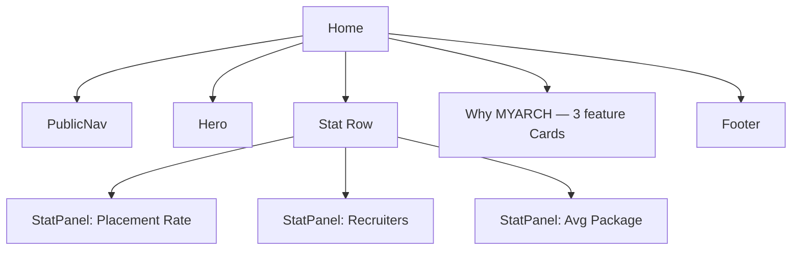
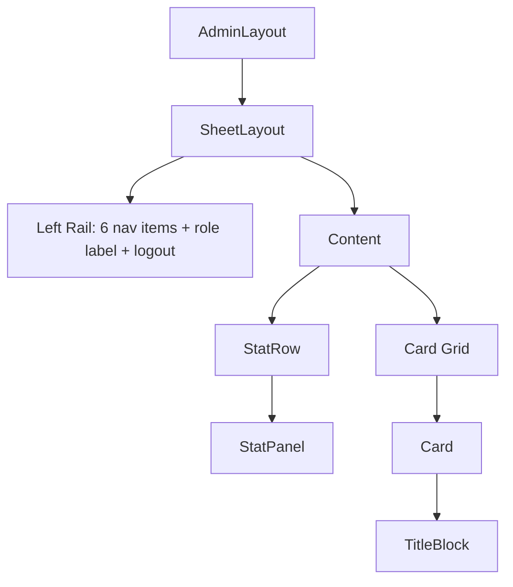

# V1 UI Specification & V1.1 Planning

**Status:** Planning only, refined. The original planning pass (Parts A–F) was reviewed and approved; this revision adds a persona-by-persona journey review, a landing-site story/CTA check, a design-consistency checklist, and a concrete implementation-milestone breakdown (Parts G–J), plus targeted expansions to Parts B/C/D/E wherever the journey review found something genuinely underspecified. No production UI code was written to produce this document or this revision — see `docs/CHANGELOG.md` for confirmation this remains a docs-only milestone.
**Purpose:** (1) a factual audit of the Version 1.0 frontend as it actually ships today, (2) the UI specification V1.1 implementation should build against, (3) the complete information architecture (including the public marketing site, which does not exist yet), (4) wireframes, (5) a reusable component plan, (6) the responsive strategy, (7) a journey-based review of that plan from every user's perspective, and (8) the implementation order.
**Relationship to frozen docs:** `docs/design/11_UI_Architecture.md`, `12_Design_System.md`, and `13_Component_Library.md` remain the frozen Version 1.0 source of truth for *intent*. This document does not replace them — it records where the shipped implementation matches that intent, where it deviates, and what V1.1 should do about each deviation. Frozen docs are not edited here.

---

## PART A — UI Audit (Version 1.0, as shipped)

### A.1 Page inventory

| Route | Portal | Purpose | Data source |
|---|---|---|---|
| `/` | — | Session-based redirect entry point only; renders no real content | `useAuth()` |
| `/login` | Public | Sign-in form | `POST /api/auth/login` |
| `/dashboard` | Admin | Overview: 3 stat tiles + batch summary cards | `/api/students`, `/api/batches`, `/api/profiles/approval-queue` |
| `/dashboard/students` | Admin | Searchable/filterable student table, archive/restore | `/api/students` |
| `/dashboard/students/[id]` | Admin | Student detail: private fields, batch reassignment, archive | `/api/students/:id`, `/api/batches` |
| `/dashboard/batches` | Admin | Batch cards, create (Secretary), status change (Secretary) | `/api/batches`, `/api/students` |
| `/dashboard/approvals` | Admin | Table of drafts awaiting review | `/api/profiles/approval-queue` |
| `/dashboard/approvals/[studentId]` | Admin | Draft detail, Approve / Request Changes | `/api/students/:id/profile/draft*` |
| `/dashboard/audit` | Admin | Read-only recent activity table | `/api/audit/recent` |
| `/dashboard/exports` | Admin | 4 CSV export cards | `/api/exports/*` |
| `/student` | Student | Own draft editor, submit, published profile view | `/api/students/:id/profile/draft`, `/profile/published` |
| `/recruiter` | Recruiter | Stats + search/filter + directory card grid | `/api/recruiters/dashboard`, `/api/recruiters/students` |
| `/recruiter/students/[id]` | Recruiter | Approved student profile detail, resume reference | `/api/recruiters/students/:id`, `/resume` |

**13 pages total.** No public marketing site exists — `/login` is the only unauthenticated page. This is the single biggest information-architecture gap against this document's own Part C.

### A.2 Layout inventory

| Layout | Applies to | Shell | Nav items |
|---|---|---|---|
| `src/app/layout.tsx` (root) | Every route | `<html>`/`<body>` + `AuthProvider` only — no visual chrome | — |
| `(admin)/layout.tsx` | All `/dashboard/*` | `SheetLayout` | Overview, Students, Batches, Approvals, Exports, Audit (6) |
| `(recruiter)/layout.tsx` | All `/recruiter/*` | `SheetLayout` | Student Directory (1) |
| `(student)/layout.tsx` | `/student` | `SheetLayout` | My Profile (1) |
| *(none)* | `/login`, `/` | Bare `<main>` per page | — |

All three authenticated layouts follow an identical pattern independently: `isLoading` → spinner text; `!isAuthenticated || role mismatch` → `router.replace("/login")`; otherwise render `SheetLayout`. This is copy-pasted three times rather than sharing one `RequireRole` primitive — a real duplication finding (see A.10).

### A.3 Shared component inventory

| Component | File | Notes |
|---|---|---|
| `Button` | `ui/button.tsx` | 4 variants: primary/secondary/ghost/destructive. One size only. No loading-spinner slot, no icon slot. |
| `Input`, `Label`, `FieldError` | `ui/input.tsx` | `FieldError` has `role="alert"` (added in the Production Readiness Sprint). No `aria-describedby` wiring to its `Input`. |
| `Select` | `ui/select.tsx` | Thin wrapper, no custom chevron/affordance beyond native. |
| `Textarea` | `ui/textarea.tsx` | Thin wrapper. |
| `Badge` | `ui/badge.tsx` | 6 variants. 5 of 6 use raw Tailwind palette classes (`emerald-500`, `amber-500`, `red-500`) — **not** tokens from `tokens.css` (see A.5). |
| `Table` family | `ui/table.tsx` | `Table`/`TableHead`/`TableRow`/`TableHeaderCell` (has `scope="col"`)/`TableCell`/`TableBody`. Horizontal-scroll wrapper present. No sorting, no pagination, no sticky header, no row density options. |
| `TitleBlock` | `title-block.tsx` | The signature drafting-sheet motif — implemented faithfully to `12_Design_System.md`'s spec (Project/Scale/Date/Drawn By + optional status slot). |
| `SheetLayout` | `sheet-layout.tsx` | Fixed `w-56` left rail + content area. **No responsive behavior at all** — see A.6. |

**Not built** (present in the frozen `13_Component_Library.md` catalogue, never implemented in Days 1–10): `Modal`/`Dialog`, `Toast`, `Tabs`, `Skeleton`, `Checkbox` (raw `<input type="checkbox">` used inline instead), `ProfileCard`, `ApprovalQueueItem`, `StatPanel`. (`PipelineBoard` and `BrochureCanvas` are correctly deferred — they're scoped to Phase 2/3.)

Two ad hoc, near-identical "big number + label" implementations exist where `StatPanel` should be one shared component: `StatCard` (inline function in `dashboard/page.tsx`) and `StatTile` (inline function in `recruiter/page.tsx`). Same concept, two copies, two names.

### A.4 Navigation audit

- Each portal hardcodes its own `NAV_ITEMS` array — three separate lists, no shared source.
- `aria-current="page"` is applied correctly on the active nav link (fixed in the Production Readiness Sprint).
- No breadcrumbs anywhere — matches `11_UI_Architecture.md`'s explicit "breadcrumb-free by design" intent.
- **The frozen doc's "Command surface (search) in the top strip" was never built.** Search exists only as a per-page inline form (students page, recruiter page) — there is no global top-strip search reachable from every screen.
- **No persistent Title Block strip at the sheet level.** `11_UI_Architecture.md`'s diagram shows a Title Block strip as a fixed structural region of every screen (bottom of the sheet). The shipped `SheetLayout` has no such region — `TitleBlock` is used only *inside* individual cards, never as the page-level frame element the original diagram specifies. This is the largest single deviation from `11_UI_Architecture.md`.
- No logout confirmation, no session-expiry warning before an access token silently expires mid-task.

### A.5 Theme / typography / color audit

- Every component correctly consumes tokens via `text-[--color-*]`/`bg-[--color-*]` arbitrary-value Tailwind syntax — **no hardcoded hex color was found anywhere in `src/`** (confirmed by grep in the Production Readiness Sprint and re-confirmed here).
- **Font-family application is copy-pasted, not centralized.** The literal string `font-[family-name:var(--font-display)]` (or `--font-body`/`--font-data`) appears inline on every single heading/label across all 13 pages — roughly 40+ occurrences of hand-typed, unchecked-by-the-compiler class strings, rather than a `<PageTitle>`/`<Heading>` component or Tailwind `@theme` font-family utility. One typo silently drops the intended typeface on that element with no build-time signal.
- **Semantic status colors are not tokens.** `tokens.css`'s own header comment claims it is "the single source of truth for color," but `Badge`'s pending/approved/rejected variants use raw Tailwind `amber-500`/`emerald-500`/`red-500`, and page-level error text uses raw `text-red-400` — none of these live in `tokens.css`. `12_Design_System.md`'s Assumptions section anticipated this ("a controlled, minimal addition to the core five-token palette") but the addition was never formalized as tokens.
- No dark/light theme switch exists (correctly matches `12_Design_System.md`'s "dark mode is the only mode for Phase 1–3" — not a gap).

### A.6 Responsiveness audit

- **Content grids reflow correctly**: dashboard batch cards, batches page, exports page, and the recruiter directory all use `grid-cols-1 sm:grid-cols-2 lg:grid-cols-3/4` — genuinely responsive.
- **Forms reflow correctly**: students/recruiter filter forms use `sm:grid-cols-2 lg:grid-cols-4`.
- **Tables have a horizontal-scroll container but no responsive column strategy** — a 6-column table (students list) on a narrow phone scrolls sideways rather than adapting (stacking, hiding secondary columns, or a card-per-row alternative).
- **The `SheetLayout` shell itself has zero responsive behavior.** The `w-56` left rail is a fixed-width flex child with no breakpoint logic at all — no hamburger, no bottom nav, no slide-out drawer. On a phone-width viewport, the content area is simply squeezed to `100vw − 224px`, which is unusable. This directly contradicts `11_UI_Architecture.md`'s explicit requirement ("The left rail collapses to a bottom or slide-out navigation below a defined breakpoint") and is the single most important functional gap this audit found — every authenticated page inherits it, since every authenticated page is wrapped in `SheetLayout`.
- No defined breakpoint tokens exist anywhere in the codebase — every responsive class uses Tailwind's default `sm`/`lg` breakpoints implicitly, with no project-specific breakpoint scale documented (see Part B).

### A.7 Accessibility audit

Re-verified as part of this audit (not just cited from history):

- Fixed in the Production Readiness Sprint and confirmed still in place: `FieldError` has `role="alert"`; `TableHeaderCell` has `scope="col"`; the active nav link has `aria-current="page"`; the student review-comment field has a proper `<Label htmlFor>`.
- Color contrast against the dark tokens remains AA-compliant or better (verified numerically in the earlier audit; token values unchanged since).
- Native semantic elements (`<button>`, `<a>`/`Link`, `<input>`, `<select>`, `<textarea>`) are used throughout — no non-semantic clickable `<div>`s found.
- **Still open**: no `aria-describedby` linking an `Input`/`Textarea` to its `FieldError`; no "skip to main content" link; `Button` has no custom focus-visible treatment (relies on the browser default, which is compliant but visually inconsistent with the dark theme); no `Modal` exists yet, so focus-trap/restore behavior (required once one is built) has never been implemented or tested.
- **New finding**: raw `<input type="checkbox">` elements (students page's "Include archived", recruiter page's "Has internship experience"/"Has certification") are unstyled — they render in the browser's default light-theme control style, which is jarringly inconsistent against the dark background and has no `--color-accent` treatment when checked.

### A.8 Empty-state audit

Every empty state found is a single line of plain gray text: *"No students found."*, *"No batches yet."*, *"No pending submissions."*, *"No recent activity."*, *"No matching students found."* — functionally correct, but this contradicts `11_UI_Architecture.md`'s explicit intent ("Empty states... are treated as first-class designed states, using the Title Block motif to explain what belongs in that space rather than a blank void"). No empty state currently uses `TitleBlock`, an icon, or a call-to-action (e.g., "Create your first batch" linking directly to the create form).

### A.9 Loading-state audit

Every loading state found is the literal text **"Loading…"** — no `Skeleton` component exists anywhere, despite being specified in `13_Component_Library.md`. This causes visible layout shift on every page once data arrives (the "Loading…" line is replaced by a table/grid of different height).

### A.10 Findings summary (prioritized)

| # | Finding | Severity | Where |
|---|---|---|---|
| 1 | `SheetLayout` has no responsive/mobile behavior at all | **Critical** | All 13 authenticated pages |
| 2 | No public marketing site exists (Home/About/Placements/Students/Recruiters/Contact) | **High** | Information architecture |
| 3 | Semantic status colors and error-red are not design tokens | Medium | `Badge`, error text sitewide |
| 4 | Font-family classes are copy-pasted ~40+ times instead of centralized | Medium | Every page |
| 5 | No `Modal`/confirmation step before destructive actions (archive, approve) | Medium | Students, Approvals |
| 6 | No `Skeleton` — every loading state causes layout shift | Medium | Every page |
| 7 | Empty states are plain text, not the specified Title-Block-first-class treatment | Low–Medium | Every list/table |
| 8 | `StatCard`/`StatTile` duplicate a single `StatPanel` concept | Low | Dashboard, Recruiter |
| 9 | Three copies of the same role-guard layout logic | Low | Admin/Recruiter/Student layouts |
| 10 | No global command/search surface | Low | Navigation |
| 11 | Unstyled native checkboxes | Low | Students, Recruiter filters |
| 12 | Inconsistent inline-vs-field-level error display across forms | Low | Batches, Students, Student detail |
| 13 | No `aria-describedby` field/error association | Low (carried from prior audit) | Every form |

---

## PART B — V1.1 UI Specification

Builds on, and does not contradict, the frozen tokens in `12_Design_System.md`. Where this section proposes something new (breakpoints, semantic tokens, additional components), it is additive.

### Design philosophy

Unchanged from `12_Design_System.md`: an architectural drafting-sheet identity — restrained dark palette, a single precise accent, monospaced data annotation, a persistent Title Block metadata motif — deliberately not a generic SaaS dashboard look. V1.1 extends this philosophy into two places it never reached in V1.0: a public-facing marketing site, and a genuinely responsive authenticated shell.

### Color palette

Existing five tokens (unchanged, still the foundation):

| Token | Value | Usage |
|---|---|---|
| `--color-background` | `#15171B` | App background |
| `--color-surface` | `#1D2024` | Panels, cards |
| `--color-text-primary` | `#ECEAE4` | Primary text |
| `--color-text-secondary` | `#8B8F98` | Secondary text, captions |
| `--color-accent` | `#4FB8D4` | Interactive/actionable elements only |

**Proposed additions** (formalizing what A.5 found already exists informally as raw Tailwind classes) — new tokens, not new colors, chosen to be close to the Tailwind shades already in use so the visual change is zero, only the source of truth changes:

| Token | Value | Usage |
|---|---|---|
| `--color-success` | `#34D399` (Tailwind emerald-400, already in use) | Approved / active / offer states |
| `--color-warning` | `#FBBF24` (Tailwind amber-400) | Pending / awaiting-review states |
| `--color-danger` | `#F87171` (Tailwind red-400, already in use) | Rejected / destructive / error text |

### Typography

Unchanged typefaces (General Sans / IBM Plex Sans / IBM Plex Mono) and type scale from `12_Design_System.md`. **Proposed addition**: a small set of typographic primitive components (`PageTitle`, `SectionHeading`, `DataLabel`) that wrap the existing font-family utility class once each per role, eliminating the ~40+ copy-pasted occurrences found in A.5. No visual change — purely a maintainability fix.

### Grid system

12-column CSS grid at the `lg` breakpoint and above (matches Tailwind's default 12-column `grid-cols-12` utility, no custom grid needed); single-column stack below `sm`. Card grids continue using Tailwind's `grid-cols-{n}` responsive utilities as they do today (A.6 confirmed this already works well) — no change needed there, only at the shell level (see Responsive Strategy).

### Breakpoints

**Not formally defined anywhere today** (A.6) — every responsive class relies on Tailwind's implicit defaults. V1.1 should declare them explicitly as tokens so the shell's new responsive behavior and every future component reference the same scale:

| Token | Width | Maps to Tailwind | Represents |
|---|---|---|---|
| `--breakpoint-sm` | 640px | `sm:` | Large phone / small tablet — filter forms and card grids go 2-column |
| `--breakpoint-md` | 768px | `md:` | Tablet — the `SheetLayout` rail switches from bottom-nav to a persistent rail |
| `--breakpoint-lg` | 1024px | `lg:` | Desktop — card grids go 3–4 column, tables gain full breathing room |
| `--breakpoint-xl` | 1280px | `xl:` | Wide desktop — public site's marketing sections cap their max-width |

### Component library

#### Cards
The `rounded-lg border border-[--color-text-secondary]/20 bg-[--color-surface] p-5` pattern is repeated verbatim across every page (batches, exports, dashboard, recruiter directory, student profile sections). V1.1 formalizes this as a `Card` primitive (`Card`, `CardHeader`, `CardBody`, `CardFooter`) so the pattern is defined once. Every existing card-shaped block in the audit becomes a direct, drop-in replacement — no visual change.

#### Buttons
Existing 4 variants retained as-is. V1.1 adds: a `size` prop (`default` | `compact`, the latter for inline table-row actions like Archive/Restore, which A.3 found look visually heavy at full size inside a table cell today) and an optional `isLoading` prop that shows a small inline spinner + disables the button, replacing the current inconsistent pattern of some pages changing button text to "Saving…" and others not disabling at all.

#### Tables
Existing `Table` family retained. V1.1 adds an optional responsive mode: below `md`, a table with a `mobileCard` render prop renders each row as a stacked card (label: value pairs) instead of a horizontally-scrolling table — used for the students list and audit log, the two tables most likely to be checked from a phone.

#### Forms
Standardize on the `FieldError` pattern already built (A.10 finding #12) — every form field gets a paired `FieldError`, and `Input`/`Textarea`/`Select` gain an `aria-describedby` wired automatically when an `id` and an adjacent error are both present, closing the accessibility gap from A.7 without changing any call site's props.

#### Dialogs
New `Modal`/`Dialog` component per the frozen `13_Component_Library.md` spec (translucent/frosted `--color-surface` overlay, focus-trapped, restores focus on close, closes on `Escape` and backdrop click). The mobile nav drawer (Part F) reuses the same focus-trap/restore behavior even though it isn't visually a centered dialog — one implementation, two presentational modes.

**Confirmation-gated flows** (expanded during the journey review in Part G — the original audit only named two of these four):
1. Archive a student (admin) — currently single-click, no confirmation.
2. Approve / Request Changes on a draft (admin) — currently single-click.
3. Submit draft for review (student) — currently single-click; submitting locks the draft from further editing until a reviewer responds, which is exactly the kind of state-changing, hard-to-reverse-in-the-moment action a confirmation step exists for, and the original audit missed it because it's on the student side, not the admin side.
4. Change a batch's lifecycle status to `GRADUATED` or `ARCHIVED` (Secretary) — currently a bare `<Select>` with no confirmation, despite this changing what recruiters can see (non-`ACTIVE` batches drop out of the recruiter directory). Changing *to* `ACTIVE` does not need confirmation (it's non-destructive); the other two transitions do.

#### Navigation
`SheetLayout` gains real responsive behavior (see Responsive Strategy) and a shared `NAV_ITEMS` sourcing pattern so the three portals' nav lists are defined next to their route group rather than duplicated ad hoc (A.4).

### Motion guidelines

Unchanged from `12_Design_System.md`: 150–200ms transitions, standard ease-out, used only to communicate state change, never decorative. Applies to the new `Modal` (fade + slight scale on enter/exit) and the new responsive nav drawer (slide, not fade, to make the spatial relationship — "this comes from off-screen" — legible).

### Accessibility rules

Carried forward from `13_Component_Library.md`'s baseline, plus this audit's specific closes:
- Every interactive component keyboard-operable; `Modal` traps and restores focus (new, since no modal existed to test this against before).
- Color never the sole indicator of state — already true (`Badge` always pairs color with a text label).
- `Input`/`Textarea`/`Select` always paired with a `Label` and, when present, an `aria-describedby`-linked `FieldError`.
- A "skip to main content" link added to `SheetLayout`, landing focus at the content region — closes A.7's open item.
- Native checkboxes replaced by a themed `Checkbox` primitive consuming the same tokens as every other form control (closes A.7's new finding).

---

## PART C — Information Architecture

### Public Website (new in V1.1 — none of this exists today)

```
/                    Home        — hero, what MYARCH is, department identity, CTA → /login
/about               About       — department mission, program overview, team/faculty
/placements          Placements  — placement statistics, past recruiters, process overview
/students            Students    — "for prospective/current students" info page (NOT the admin student list)
/recruiters           Recruiters  — "why recruit from us" pitch, CTA → recruiter account request
/contact             Contact     — contact form / department contact details
/login               Login       — existing page, unchanged
```

The public site is deliberately separate from, and much lighter than, the authenticated portals — no `SheetLayout`, no left rail. It uses the same design tokens (dark background, accent cyan, Title Block motif for statistics) so the transition from public site → login → authenticated portal feels like one product, not a marketing site bolted onto a different app.

**Content container**: every public page's content (excluding the full-bleed nav/footer background) sits in a centered container, `max-width: 1280px` (matching the `xl` breakpoint token), with `px-4` on mobile growing to `px-8` at `lg` and above — one container spec reused by every page, not invented per-page.

**Account-creation reality, stated explicitly so no page implies self-service signup that doesn't exist:**
- **Students** do not self-register. Accounts are created by the Secretary/Coordinator once a student is enrolled (`ADMIN_GUIDE.md`). The public Students page's CTA is *"Already enrolled? Your Coordinator sets up your account — sign in here"* → `/login`, not a signup form.
- **Recruiters** do not self-register either. The public Recruiters page's CTA (*"Request recruiter access"*) submits the Contact form with a "Recruiter" reason selected; the Secretary creates the account out-of-band afterward (see `ADMIN_GUIDE.md` — this matches how every seeded account in this project has been created, and no self-service recruiter signup use case exists in the backend, which is frozen for this milestone).
- **Alumni** (future — not built, but the public IA should not foreclose it): add a single, low-commitment CTA to the Placements and About pages — *"Alumni? We're building a way to stay connected — leave your email"* — a mailing-list-style form (name + email only) distinct from the Contact form, landing in the same place (Contact submissions) until a dedicated alumni feature exists. This satisfies the requirement to have *a* CTA for alumni now, without inventing alumni-portal scope that isn't part of Phase 1.
- **General visitors** (parents, prospective applicants, accreditation reviewers, press) aren't asked to log in or contact anyone — their path is Home → About/Placements via nav, which already exists; no dedicated CTA is needed beyond making sure Home's hero doesn't *only* offer "Login," which the refinement below addresses.

### Authenticated Portals (existing structure, retained)

```
Student portal            /student
  └─ My Profile            (only page today; V1.1 candidate additions below)

Recruiter portal           /recruiter
  ├─ Student Directory      /recruiter
  └─ Student Profile        /recruiter/students/[id]

Admin portal (Secretary/Coordinator)     /dashboard
  ├─ Overview               /dashboard
  ├─ Students               /dashboard/students
  │    └─ Student Detail    /dashboard/students/[id]
  ├─ Batches                /dashboard/batches
  ├─ Approvals              /dashboard/approvals
  │    └─ Review Draft      /dashboard/approvals/[studentId]
  ├─ Exports                /dashboard/exports
  └─ Audit                  /dashboard/audit
```

No structural change to the authenticated portals is proposed for V1.1 — the gap is depth of polish (responsiveness, empty/loading states, confirmation dialogs) within the existing structure, not new sections. The one open question worth flagging: `18_Open_Questions.md`'s Q7 (peer visibility among students) would add a page under the Student portal if resolved "yes" — out of scope until that decision is made.

---

## PART D — Wireframes

Full detail for the 7 new public pages (highest-value new planning work) and one representative page per authenticated portal, showing the shell + a content pattern. Every other existing authenticated page already has a real, shipped implementation (see Part A) and follows one of the patterns wireframed below (List+Filter+Table, Detail+Actions, or Card Grid) — repeating near-identical boxes for all 13 would add bulk without new information, so the remaining pages are listed against their pattern in the table at the end of this section instead.

### D.1 Public — Home

```
DESKTOP (≥1024px)                                    MOBILE (<640px)
┌──────────────────────────────────────────┐         ┌───────────────────┐
│ MYARCH       Home About Placements ...  Login│      │ MYARCH       ☰    │
├──────────────────────────────────────────┤         ├───────────────────┤
│                                            │         │                   │
│         HERO: headline + subhead          │         │   HERO (stacked)  │
│         [Explore Placements] [Login]      │         │   [Explore]       │
│                                            │         │   [Login]         │
├──────────────────────────────────────────┤         ├───────────────────┤
│  StatPanel   StatPanel   StatPanel        │         │   StatPanel       │
│  (placement) (recruiters)(avg. package)   │         │   StatPanel       │
├──────────────────────────────────────────┤         │   StatPanel       │
│  "Why MYARCH" — 3-column feature blurb    │         ├───────────────────┤
├──────────────────────────────────────────┤         │  Feature (stacked)│
│  Footer: About · Contact · Login          │         ├───────────────────┤
└──────────────────────────────────────────┘         │  Footer           │
                                                        └───────────────────┘
```



Sections: nav, hero, stat row (3 `StatPanel`s sourced from the Public Placement Dataset), feature grid, footer. Mobile: nav collapses to a hamburger (`☰`) opening a full-height slide-down menu; stat row and feature grid go single-column.

**Hero CTA refinement (from the journey review, Part G):** a single "Login" button next to "Explore Placements" doesn't tell a first-time visitor *who* login is for — a student, a recruiter, and a staff member all see the identical button with no signal it'll route them correctly. The hero keeps exactly two buttons (adding a third starts to look like a button wall), but rephrases them audience-agnostically: **"Explore Placements"** (primary, leads with the department's actual outcomes — serves the general visitor) and **"Sign In"** (secondary — serves students/recruiters/staff alike; the post-login redirect, already built, routes each role correctly, so one button genuinely does serve all three). The **"For Students"** / **"For Recruiters"** distinction is instead made by the nav itself (see PublicNav spec below) and by each of those two pages' own page-specific CTA once the visitor has self-identified by navigating there — this avoids the hero trying to branch by audience before the visitor has told it who they are.

**`PublicNav` exact spec** (applies identically to all 7 public pages, expanding Part E's entry):
- Desktop (≥`md`, 768px): a single horizontal strip, `--color-surface` background, `--color-text-secondary`/20 bottom border (matching `SheetLayout`'s rail border treatment, so the two navs read as one family per Part I). Left: "MYARCH" wordmark (links to `/`). Right, in order: Home, About, Placements, Students, Recruiters, Contact, then a visually distinct **Sign In** button (`Button variant="secondary"`, not a plain link — the one item that should look actionable, not just navigational).
- Active-page link: `--color-accent` text + `aria-current="page"` — identical treatment to `SheetLayout`'s active rail item (Part I consistency rule).
- Mobile (<`md`): wordmark + `☰` icon-button only. Tapping `☰` opens a full-height overlay (same `Modal`-style focus trap as Part B's Dialogs, presented as a slide-down rather than a centered dialog) listing all 7 items plus Sign In, each full-width and tappable; closes on selection, `Escape`, or tapping `☰` again (now rendered as `✕`).

**`Footer` exact spec** (applies identically to all 7 public pages, expanding Part E's entry): three columns at `lg` and above, stacked at `md` and below —
1. **About MYARCH** — one-line description + "Department of Architecture & Planning, VNIT Nagpur."
2. **Quick Links** — About, Placements, Students, Recruiters, Contact (mirrors the nav, for visitors who scrolled past it).
3. **Contact** — department email + a link to `/contact`.
Bottom strip below the three columns: `© {year} MYARCH — Department of Architecture & Planning, VNIT Nagpur.` in `--color-text-secondary`, `--font-data` (matching the Title Block's metadata-label typographic treatment, tying the footer into the same drafting-sheet vocabulary rather than reading as generic boilerplate).

### D.2 Public — About

```
DESKTOP                                    MOBILE
┌──────────────────────────────┐           ┌───────────────┐
│ Nav                            │          │ Nav (☰)        │
├────────────────────────────────┤          ├───────────────┤
│ Page title: About the Department│          │ Title (stack) │
├──────────────┬─────────────────┤          ├───────────────┤
│ Mission text │  Department      │          │ Mission text  │
│ (prose)      │  photo/graphic   │          ├───────────────┤
│              │                  │          │ Graphic       │
├──────────────┴─────────────────┤          ├───────────────┤
│  Faculty/Team card grid (3-col) │          │ Team (1-col)  │
├─────────────────────────────────┤          ├───────────────┤
│ Footer                          │          │ Footer        │
└─────────────────────────────────┘          └───────────────┘
```
Component hierarchy: `PublicNav → PageHeader → TwoColumnProse → CardGrid(TeamCard×n) → Footer`. Mobile: two-column prose stacks; team grid single-column.

### D.3 Public — Placements

```
DESKTOP                                          MOBILE
┌────────────────────────────────────┐           ┌───────────────┐
│ Nav                                  │          │ Nav (☰)        │
├──────────────────────────────────────┤          ├───────────────┤
│ Title: Placements                    │          │ Title         │
│ StatPanel row (rate / package / count)│         │ StatPanel×3   │
├──────────────────────────────────────┤          │ (stacked)     │
│ "Past Recruiters" logo/name grid      │          ├───────────────┤
│ (4-col)                               │          │ Recruiters    │
├──────────────────────────────────────┤          │ (2-col)       │
│ "Process" — 4-step numbered timeline  │          ├───────────────┤
├──────────────────────────────────────┤          │ Process       │
│ CTA card: "Recruiting? Get in touch"  │          │ (stacked)     │
├──────────────────────────────────────┤          ├───────────────┤
│ Footer                                │          │ CTA / Footer  │
└────────────────────────────────────────┘         └───────────────┘
```
Data source: the existing `Public Placement Dataset` export's underlying query, surfaced read-only (no auth) via a new lightweight public endpoint — a V1.1 backend consideration, not built in this planning phase (backend is frozen for this milestone). **Interim implementation guidance**: Milestone 4 (Part J) should not block on that endpoint existing. Ship the page with the three `StatPanel`s reading from a small local constants file (department-provided figures, refreshed manually) — identical visual output, no loading state needed yet — and swap the data source to the real endpoint in a follow-up milestone once it exists. This keeps the milestone independently shippable per the Quality Check's testability requirement.

### D.4 Public — Students (prospective/current-student info page)

```
DESKTOP                                    MOBILE
┌──────────────────────────────┐           ┌───────────────┐
│ Nav                            │          │ Nav (☰)        │
├────────────────────────────────┤          ├───────────────┤
│ Title: For Students             │          │ Title          │
│ "How the profile process works" │          │ Steps (stack)  │
│ — 4-step visual (Draft → Submit │          ├───────────────┤
│   → Review → Published)         │          │ FAQ (stack)    │
├──────────────────────────────────┤          ├───────────────┤
│ FAQ accordion (2-col)            │          │ CTA: Login     │
├──────────────────────────────────┤          ├───────────────┤
│ CTA: "Already have an account?  │          │ Footer         │
│  Log in" → /login                │          │                │
├──────────────────────────────────┤          │                │
│ Footer                           │          │                │
└──────────────────────────────────┘          └───────────────┘
```
This is an informational page, not the authenticated student portal — it explains the draft→approval workflow to someone who hasn't logged in yet. Per the account-creation clarity established above, its final CTA reads *"Already enrolled? Your Coordinator sets up your account — sign in here"*, not "Sign up" — a real fix from the journey review, since a "Sign Up" CTA here would promise something the product doesn't do.

### D.5 Public — Recruiters (marketing page, distinct from the authenticated recruiter portal)

```
DESKTOP                                        MOBILE
┌────────────────────────────────────┐         ┌───────────────┐
│ Nav                                  │        │ Nav (☰)        │
├──────────────────────────────────────┤        ├───────────────┤
│ Title: Recruit from MYARCH           │        │ Title          │
│ Pitch copy + StatPanel row            │        │ Pitch + Stats │
├──────────────────────────────────────┤        │ (stacked)     │
│ "What you get" — 3-col feature grid   │        ├───────────────┤
│ (portfolio-first profiles, filters,   │        │ Features      │
│  CSV export... conceptually, not the  │        │ (stacked)     │
│  literal admin feature list)          │        ├───────────────┤
├──────────────────────────────────────┤        │ CTA           │
│ CTA card: "Request recruiter access"  │        ├───────────────┤
│ → contact form or /contact            │        │ Footer         │
├──────────────────────────────────────┤        └───────────────┘
│ Footer                                │
└────────────────────────────────────────┘
```
CTA mechanism, per the account-creation clarity above: the button routes to `/contact` with the reason field pre-selected to "Recruiter access," not a self-service signup form — the Secretary provisions the account afterward. Page copy should say so plainly (e.g. *"Our team sets up your account within one business day"*) — exact wording is a content decision, see Open Questions.

### D.6 Public — Contact

```
DESKTOP                              MOBILE
┌────────────────────────┐          ┌───────────────┐
│ Nav                      │         │ Nav (☰)        │
├──────────────────────────┤         ├───────────────┤
│ Title: Contact            │         │ Title          │
├─────────────┬────────────┤         ├───────────────┤
│ Contact form │ Dept.       │        │ Contact form  │
│ (name/email/ │ address,    │        │ (stacked)     │
│  message)    │ email, map  │        ├───────────────┤
│ [Send]       │ embed       │        │ Dept. info    │
├─────────────┴────────────┤         ├───────────────┤
│ Footer                    │         │ Footer         │
└────────────────────────────┘        └───────────────┘
```
Component hierarchy: `PublicNav → PageHeader → TwoColumn(ContactForm, ContactDetails) → Footer`.

**Contact form exact field spec** (so implementation doesn't invent one): Name (`Input`, required), Email (`Input type="email"`, required), Reason (`Select`, options: General Inquiry / Student / Recruiter Access / Press, defaults to General Inquiry — the Recruiters/Students pages' CTAs pre-select the relevant option per D.4/D.5), Message (`Textarea`, required, 2000-char max — matching the max-length convention already used server-side for free-text fields elsewhere, e.g. review comments), `Button variant="primary"` labeled "Send". On success, the form is replaced by a confirmation message in place (not a redirect) — *"Thanks — we'll get back to you shortly."* Submitting this form requires a new, unauthenticated backend endpoint that does not exist yet — a V1.1 backend consideration like Placements' stats endpoint, not built in this UI-planning phase.

### D.7 Public — Login (existing, unchanged)

```
DESKTOP & MOBILE (already responsive — centered card, works at any width)
┌───────────────────────────┐
│                             │
│      ┌───────────────┐     │
│      │ MYARCH         │     │
│      │ Department     │     │
│      │  sign in       │     │
│      │                │     │
│      │ Email    [___] │     │
│      │ Password [___] │     │
│      │ [Sign in]      │     │
│      └───────────────┘     │
│                             │
└───────────────────────────┘
```
No changes proposed — already matches the design system and is inherently responsive (a single centered card has no layout to break).

### D.8 Authenticated — Admin Shell + Dashboard Overview (representative: Card Grid pattern)

```
DESKTOP (≥768px)                                         MOBILE (<768px) — V1.1 target, not shipped today
┌──────────┬──────────────────────────────────┐          ┌─────────────────────────┐
│ MYARCH   │  Dashboard Overview               │          │ MYARCH   Overview   ☰   │
│ Secretary│                                    │          ├─────────────────────────┤
├──────────┤  [StatPanel][StatPanel][StatPanel] │          │ [StatPanel]             │
│ Overview │                                    │          │ [StatPanel]             │
│ Students │  Batch Summary                     │          │ [StatPanel]             │
│ Batches  │  [Card][Card][Card]                │          ├─────────────────────────┤
│ Approvals│  [Card][Card][Card]                │          │ Batch Summary           │
│ Exports  │                                    │          │ [Card]                  │
│ Audit    │                                    │          │ [Card]                  │
│          │                                    │          ├─────────────────────────┤
│ Log out  │                                    │          │ (tap ☰ → slide-down nav)│
└──────────┴──────────────────────────────────┘           └─────────────────────────┘
```

Mobile behavior (V1.1, not shipped): below `md` (768px), the left rail collapses behind the `☰` icon in the top strip; tapping it slides down a full-width menu with the same 6 links plus Log out, closing on selection or outside-tap. This is the fix for A.6/A.10 finding #1, applied identically to all three portal shells.

**Coordinator scope indicator (new — from the journey review, Part G):** every list/count a Coordinator sees is already server-side scoped to their assigned batch(es), but nothing in the shell ever *says so* — a Coordinator with more than one assigned batch has no way to tell, from the UI alone, that they're looking at a subset rather than the whole department. `SheetLayout`'s role label gains a second line: under "Coordinator," a small `--color-text-secondary` line listing their scoped batch name(s) (e.g., "B.Arch 2026" or "2 batches" if more than one, expandable to a tooltip listing them). Secretary's label is unchanged (they have no scope to disclose). This is a small addition to the existing `SheetLayout` component, not a new one.

### D.9 Authenticated — Admin: Approval Review (representative: Detail + Actions pattern)

```
DESKTOP                                          MOBILE
┌──────────┬────────────────────────────┐        ┌─────────────────────┐
│ Rail     │ Bilal Khan      [Pending]   │        │ ☰  Bilal Khan [Pend]│
│          │                              │       ├─────────────────────┤
│          │ Bio / Skills / Software      │        │ Bio/Skills/Software │
│          │ (read-only card)              │       │ (stacked, full-w)  │
│          │                              │       ├─────────────────────┤
│          │ [Approve]                    │        │ [Approve]  (full-w)│
│          │                              │       │ Comment [_______]   │
│          │ Comment [___________]        │        │ [Request Changes]  │
│          │ [Request Changes]            │        └─────────────────────┘
└──────────┴────────────────────────────┘
```
V1.1 changes: `[Approve]` and `[Request Changes]` both open a `Modal` confirmation (respectively: "Publish Bilal Khan's profile? This makes it visible to recruiters immediately." / "Send these change requests back to Bilal Khan?") before calling the API — closes A.10 finding #5. **New (journey review): a "← Back to Approval Queue" link above the student name** — the shipped page has no way back except the rail's single "Approvals" link or the browser back button, a small but real gap for a reviewer processing several drafts in a row. Everything else matches the shipped page.

### D.10 Authenticated — Student Portal (representative: Form + Status pattern)

```
DESKTOP                                          MOBILE (already close to shipped — this page is closest to responsive-ready today)
┌──────────┬────────────────────────────┐        ┌─────────────────────┐
│ My Profile│ Public Profile Draft [Draft]│       │ ☰  Draft   [Draft]  │
│ Log out   │                              │      ├─────────────────────┤
│           │ Bio [textarea]               │       │ Bio [textarea]      │
│           │ Skills [input]                │      │ Skills [input]      │
│           │ Software [input]              │      │ Software [input]    │
│           │ Portfolio Links [input]       │      │ Links [input]       │
│           │ [Save Draft] [Submit]         │       │ [Save Draft]        │
│           │                              │      │ [Submit]            │
│           │ Published Profile (if any)    │      ├─────────────────────┤
└──────────┴────────────────────────────┘         │ Published (if any)  │
                                                     └─────────────────────┘
```
V1.1 changes, both from the journey review (Part G): **`[Submit]` opens a `Modal` confirmation** ("Submit for review? Your draft will be locked until a reviewer responds.") — submitting is a state-locking action and the audit's original Modal list only covered admin-side actions, missing this one. **The "Published Profile" section gains a "Preview as a recruiter sees it" link/expansion** rendering the *full* recruiter-facing layout (skills/software/projects/certifications/internships/portfolio — the same fields and order as D.11's detail page), not just the bio summary shipped today — a student currently has no way to see exactly what a recruiter sees.

### D.11 Authenticated — Recruiter: Directory + Profile Detail (representative: Card Grid → Detail pattern)

```
DESKTOP                                                MOBILE
┌──────────┬────────────────────────────────┐          ┌─────────────────────┐
│ Directory│ Welcome / stats / search form    │         │ ☰  Directory         │
│ Log out  │                                   │        ├─────────────────────┤
│          │ [Card][Card][Card]                │        │ Stats (stacked)     │
│          │ [Card][Card][Card]  → click card   │       │ Search (stacked)    │
│          │    → /recruiter/students/[id]      │       ├─────────────────────┤
└──────────┴────────────────────────────────┘          │ [Card]              │
                                                          │ [Card]              │
Detail page: single-column max-w-2xl card list           └─────────────────────┘
(Skills/Software/Projects/Certs/Internships/             Detail page: already
Portfolio/Resume button) — already effectively            single-column, works
single-column today, so it already reads fine             as-is on mobile.
on mobile even without shell fixes.
```
V1.1 change (journey review): **the detail page gains a persistent "← Back to Directory" link**, not just the error-state-only back button it has today — a recruiter comparing several candidates currently has no inline way back except the rail's single nav item.

### D.12 Remaining existing pages — pattern reference (not re-diagrammed individually)

| Page | Pattern it follows |
|---|---|
| `/dashboard/students` | List+Filter+Table (D.9's rail + a filter form + `Table`, same as Approvals list without the detail drill-in shown) |
| `/dashboard/students/[id]` | Detail + Actions (D.9) |
| `/dashboard/batches` | Card Grid (D.8) + inline create form |
| `/dashboard/approvals` | List+Filter+Table (simpler than D.9 — no filters, just a table linking to D.9's detail page) |
| `/dashboard/audit` | List+Filter+Table (read-only, no actions column) |
| `/dashboard/exports` | Card Grid (D.8), 4 static cards instead of data-driven |

---

## PART E — Reusable Component Plan

| Component | Purpose | Key props | Reuse locations |
|---|---|---|---|
| `Card`, `CardHeader`, `CardBody`, `CardFooter` | Formalizes the repeated bordered-surface pattern (A.5/Cards) | `children`; no variants needed — one visual treatment | Batches, Exports, Dashboard, Recruiter directory, Student profile sections, all new public pages |
| `Button` *(extended)* | Existing primitive, extended | `variant` (existing 4), `size` ("default" \| "compact", new), `isLoading` (new) | Every page with an action |
| `Input`, `Textarea`, `Select` *(extended)* | Existing primitives, extended with automatic `aria-describedby` | `id`, `label`, `error` (new convenience props, existing manual composition still works) | Every form |
| `Checkbox` *(new)* | Themed checkbox replacing raw `<input type="checkbox">` | `checked`, `onChange`, `label` | Students filter, Recruiter filter |
| `FieldError` *(existing, unchanged)* | Per-field validation message, `role="alert"` | `children` | Every form |
| `Badge` *(unchanged, tokens updated under the hood)* | Status indicator, color + label always paired | `variant` (existing 6, now backed by the 3 new semantic tokens) | Students, Batches, Approvals, Student portal, Recruiter directory |
| `Table` family *(extended)* | Data-dense list rendering | adds optional `mobileCard` render prop | Students list, Approvals queue, Audit log |
| `TitleBlock` *(unchanged)* | The signature metadata motif | `project`, `scale`, `date`, `drawnBy`, `status?` | Cards sitewide, plus every new empty-state (per A.8's fix) |
| `StatPanel` *(new — replaces `StatCard`/`StatTile` duplication)* | Big-number + `TitleBlock` metadata, one canonical implementation | `label`, `value`, `scope`, `asOf?` | Dashboard, Recruiter portal, all 3 public pages with stats (Home, Placements, Recruiters) |
| `Modal` / `Dialog` *(new)* | Focus-trapped confirmation/edit overlay, frosted `--color-surface` per `12_Design_System.md`; also powers the mobile nav drawer's focus-trap | `isOpen`, `onClose`, `title`, `children`, `footer` | Archive confirmation, Approve/Request Changes confirmation, Submit-for-review confirmation (student), batch status change to GRADUATED/ARCHIVED (Secretary), mobile nav drawer (public + authenticated) |
| `Toast` *(new)* | Transient, auto-dismissing feedback — replaces the current persistent inline `{notice && <p>}` pattern | `message`, `variant` ("success" \| "error"), `duration` | Every page that currently shows an inline save/error notice |
| `Skeleton` *(new)* | Loading placeholder matching the shape of incoming content, avoids layout shift | `shape` ("card" \| "table-row" \| "text") | Every page's current "Loading…" text |
| `EmptyState` *(new)* | First-class empty-state treatment using `TitleBlock`, per A.8 | `title`, `description`, `action?` (label + href/onClick) | Every table/grid's empty case |
| `PublicNav` *(new)* | Top nav for the unauthenticated public site — collapses to a hamburger below `md` | `currentPath` | All 7 public pages |
| `Footer` *(new)* | Shared public-site footer | none (static content) | All 7 public pages |
| `RequireRole` *(new, internal)* | Replaces the 3 copy-pasted role-guard blocks in `(admin)/(recruiter)/(student)` layouts | `allowedRoles`, `children` | The 3 portal layouts |
| `PageTitle`, `SectionHeading`, `DataLabel` *(new, typographic)* | Centralizes the copy-pasted font-family utility class | `children`; no other props | Every page (replaces ~40+ inline occurrences) |
| `SheetLayout` *(extended, not replaced)* | Existing shell, gains real responsive behavior plus an optional batch-scope sub-label under the role name (journey review, Part G) | adds internal responsive state and an optional `scopeLabel?: string` prop; existing call sites (`navItems`, `roleLabel`, `onLogout`, `children`) unchanged | All 3 authenticated portals |

---

## PART F — Responsive Strategy

- **Breakpoint scale**: formalized in Part B (`sm` 640 / `md` 768 / `lg` 1024 / `xl` 1280), matching Tailwind defaults so no build config change is needed — only documentation and consistent usage.
- **Public site**: mobile-first. Single-column by default, reflowing to multi-column feature/stat grids at `sm`/`lg`. Nav collapses to a hamburger below `md`. This matches `11_UI_Architecture.md`'s existing "mobile-first for student-facing... public" principle, extended to the new public pages it never covered.
- **Authenticated shell (`SheetLayout`)**: desktop-first per `11_UI_Architecture.md`'s existing principle for admin/coordinator/recruiter roles, but **must** gain the responsive collapse the frozen doc already specifies and V1.0 never implemented (A.6/A.10 #1) — left rail hidden below `md`, replaced by a `☰` toggle in a new top strip revealing a slide-down menu with the same nav items.
- **Student portal specifically**: closest to responsive-ready already (D.10) since its content is a single-column form; only the shell wrapper needs the fix above, not the page content itself.
- **Tables**: gain an optional mobile card-per-row mode (Part E) for the two tables most likely to be read on a phone (students list, audit log); the approvals queue and batch data are lower priority since they're reviewed in batches at a desk, matching the desktop-first admin-workflow assumption already documented.
- **Images/portfolio content**: out of scope for this responsive pass — no object storage integration exists yet (`TECHNICAL_DEBT.md`), so there is no image-heavy content to make responsive today; revisit once file upload ships.
- **Testing baseline for V1.1 implementation**: verify every page at 375px (small phone), 768px (tablet/`md`), and 1280px (desktop/`xl`) — the three widths this document's breakpoints are anchored to.

---

## PART G — User Journey Review

Each journey below was walked end-to-end against Part C's information architecture, as that persona, looking specifically for friction, unnecessary navigation, duplicated actions, and missing pages. Findings already folded into Parts B/D/E above are cross-referenced rather than repeated in full; this section is the record of *why* those specific changes were made.

### G.1 Public visitor journey

**Path:** lands on Home → wants department context → About → wants outcomes → Placements → self-identifies as a student or recruiter → Students or Recruiters → wants to ask something → Contact → eventually → Sign In.

- **Friction found and fixed**: a single "Login" button gives a first-time visitor no signal of *who* it's for. Fixed by keeping the hero audience-agnostic ("Explore Placements" + "Sign In") and letting the Students/Recruiters pages carry the audience-specific CTA once the visitor has self-identified by navigating there (D.1).
- **Missing page found and fixed**: no consideration for alumni anywhere in the original IA, despite being named as a required future CTA. Fixed with a lightweight, low-commitment mailing-list-style CTA on About/Placements rather than a full alumni feature (Part C addendum).
- **No unnecessary navigation found**: the 7-page public IA is flat (no nesting), and every page is reachable from `PublicNav` in one click — no journey requires more than two navigations to reach its destination.

### G.2 Recruiter journey

**Path (unauthenticated):** Recruiters (public) → Contact (request access) → *(out-of-band: Secretary creates the account)* → Sign In → `/recruiter` → browse directory → open a profile → download resume reference.

- **Friction found and fixed**: the public Recruiters page's CTA read as if it might be self-service signup. Fixed by stating the account-provisioning mechanism explicitly in the page copy (Part C addendum, D.5).
- **Friction found and fixed**: no way back from a student's profile detail page to the directory except the rail's single nav item or the browser back button — real friction for a recruiter comparing several candidates in one session. Fixed with a persistent "← Back to Directory" link (D.11).
- **Gap noted, not fixed (out of scope)**: once authenticated, a recruiter has no path back to the public site's Contact/About pages, and no self-service way to update their own contact details or password — both are backend-scope (account self-management), not a UI-only fix, and the backend is frozen for this milestone. Flagged here so it isn't mistaken for an oversight; a candidate for a future backend milestone, not V1.1's UI-only scope.

### G.3 Student journey

**Path:** Sign In → `/student` → edit draft → Save → Submit → *(wait for review, notified by email)* → Approved (published profile appears) or Changes Requested (comment shown, edit, resubmit).

- **Friction found and fixed**: Submit is a state-locking action (the draft becomes uneditable until reviewed) but had no confirmation step — the original audit's Modal list only covered admin-side actions. Fixed by adding a Submit confirmation (Part B, D.10).
- **Missing capability found and fixed**: a student cannot currently preview their profile in the same shape a recruiter will actually see it (the shipped page shows only a bio summary). Fixed by adding a "Preview as a recruiter sees it" expansion reusing the same field set/order as the recruiter detail page (D.10).
- **No unnecessary navigation found**: the portal is intentionally one page deep — there's nothing to streamline here, which is itself a confirmation the shallow IA is working as intended for this role.
- **Non-issue, confirmed rather than flagged**: no in-app notification center exists, but review decisions are already emailed (per the backend's notification system) — this is a deliberate, already-correct design, not a gap, and is noted here so a future reviewer doesn't "fix" something that isn't broken.

### G.4 Coordinator journey

**Path:** Sign In → `/dashboard` (same shell as Secretary, server-side scoped to assigned batch(es)) → Overview → Students/Approvals (scoped) → review a draft → Batches (view-only) → Exports (scoped, Recruiter Directory hidden) → Audit (own actions only).

- **Friction found and fixed**: every list a Coordinator sees is already correctly scoped server-side, but nothing in the UI ever discloses *that it's scoped* — a Coordinator assigned to more than one batch has no way to tell they're seeing a subset. Fixed with a scope sub-label under the role name in the rail (D.8, `SheetLayout` extension in Part E).
- **Potential confusion identified, confirmed as intentional (no change needed)**: Coordinators see the full 6-item nav including "Batches," even though they can't create batches or change status there. Reviewed and confirmed this is correct as-is — being able to *view* batch context without edit rights is useful, and the page already conditionally hides Secretary-only controls; the nav item itself does not need to disappear.
- **No duplicated actions found.**

### G.5 Secretary journey

**Path:** Sign In → `/dashboard` → full, unscoped access to every admin page, including Batches (create/status-change), Recruiter Directory export, and every export.

- **Missing page found, flagged rather than fixed**: there is no page anywhere for the Secretary to create or manage Coordinator or Recruiter accounts, despite `canManageCoordinatorAccounts`/`canManageRecruiterAccounts` existing as backend permission functions. Account provisioning today happens entirely out-of-band (the seed script, or direct database access) — `ADMIN_GUIDE.md` already documents this as the current reality. Building this UI (and the account-creation API it would need) is real, valuable future scope, but it's a **new capability**, not a refinement of an existing page, and the backend is frozen for this milestone — so it is recorded here as a known gap for a future planning pass, not designed now.
- **Friction found and fixed**: changing a batch's status to `GRADUATED`/`ARCHIVED` is consequential (it removes the batch from recruiter visibility) but ships as a bare, unconfirmed `<Select>`. Fixed by adding it to the confirmation-modal list (Part B), while leaving the non-destructive transition *to* `ACTIVE` unconfirmed.
- **No unnecessary navigation found** — the Secretary's journey is the most-used, most-tested path in the product (Days 1–10 built and tested every one of these pages against Secretary access first), and the audit found nothing structurally wrong with it beyond the two items above.

---

## PART H — Landing Website: Story Completeness & Calls-to-Action

Verifying the public site "tells a complete story" means checking that each named subject has a page *and* that the pages connect to each other, not just that seven routes exist in a list.

| Story beat | Page(s) | Connects to |
|---|---|---|
| Who we are | Home, About | Placements (proof), Students/Recruiters (audience-specific next step) |
| What we've achieved | Placements | Home (summary stats), Students/Recruiters (credibility for both audiences) |
| What's in it for a student | Students | Contact (n/a — students don't self-register), Login |
| What's in it for a recruiter | Recruiters | Contact (request access) |
| How to reach a human | Contact | Reachable from every page's nav and footer |
| How to get into the product | Login | Reachable from every page's nav |

This is a closed loop — every page either leads to another page in the story or to Sign In/Contact, and nothing dead-ends. The one gap found (Alumni, addressed in Part C) has been closed with a minimal CTA rather than left unaddressed or over-built into a full feature.

**Calls-to-action, final state after this refinement pass:**

| Audience | CTA | Destination | Note |
|---|---|---|---|
| Students | "Already enrolled? Sign in here" | `/login` | Not "Sign up" — see Part C |
| Recruiters | "Request recruiter access" | `/contact` (Reason pre-set to "Recruiter Access") | Not self-service — see Part C |
| Alumni *(future)* | "Stay connected — leave your email" | `/contact` (lightweight variant) | Placeholder CTA only; no alumni feature built |
| General visitors | "Explore Placements" | `/placements` | The hero's primary button; serves anyone not ready to commit to logging in or contacting anyone |

---

## PART I — Design Consistency Checklist

A page-by-page component/token audit would just repeat Part E; this is the standing checklist implementation should verify itself against for **every** page (public or authenticated) before considering it done, so nothing "feels visually disconnected" per this review's brief.

- [ ] **Typography**: every heading uses `PageTitle`/`SectionHeading` (Part B), never an inline `font-[family-name:...]` class — this is what makes the ~40+ copy-pasted occurrences (A.5) actually go away rather than just being documented as a known issue.
- [ ] **Spacing**: every page uses the existing 4px-base spacing tokens (`p-5` card padding, `gap-4` grid gaps, etc., already consistent per A.5) and the new shared container spec (Part C addendum, `max-width: 1280px`) — no page invents its own padding scale.
- [ ] **Cards**: every bordered-surface block is the `Card` primitive (Part B), not a hand-rolled `rounded-lg border ... bg-[--color-surface] p-5` div — applies equally to public feature/stat cards and authenticated data cards.
- [ ] **Tables**: only used where genuinely data-dense (students list, audit log) — the public site has none, correctly.
- [ ] **Forms**: every input is `Input`/`Textarea`/`Select`/`Checkbox` with a `Label` and, where relevant, a `FieldError` — the Contact form (new) follows the identical pattern as the authenticated Batches/Students forms, not a separate "marketing form" style.
- [ ] **Buttons**: `primary` reserved for the one main action per view (matches the existing accent-is-scarce discipline); public-site CTAs use the same `primary`/`secondary` variants as authenticated actions, never a bespoke "hero button" style.
- [ ] **Navigation**: `PublicNav` and `SheetLayout` are structurally different (top strip vs. left rail — intentional, since one is a marketing site and one is an application shell) but share the same active-state treatment (`--color-accent` text + `aria-current="page"`), the same hover treatment, and the same typographic scale — so despite the structural difference, they read as one family, not two products.
- [ ] **Animations**: exactly one motion system (Part B's Motion guidelines — 150–200ms, ease-out, state-change-only) applies everywhere: `Modal` open/close, the mobile nav drawer (both public and authenticated), hover states on public feature cards, and the existing authenticated hover/focus states. No page introduces a second motion vocabulary (no bounce, no page-transition animation, no scroll-triggered reveal animation — the last of these is a common marketing-site default this project deliberately opts out of, consistent with `12_Design_System.md`'s "restrained motion" principle).
- [ ] **Icons**: no icon library is introduced. The only icon-like elements in this entire specification are the hamburger (`☰`/`✕`) glyphs, sized via the existing type scale — consistent with the project's stated preference for owning components rather than pulling in dependencies (`13_Component_Library.md`'s Component Ownership Model).
- [ ] **Empty/loading states**: every list uses `EmptyState`/`Skeleton` (Part E), never bare "Loading…" text or a plain empty-text paragraph — applies to both new public-site data (Placements' stats, once the endpoint exists) and every existing authenticated list.

---

## PART J — Implementation Milestones

The task's example milestone list (Global layout → Home → About → Placements → Students → Recruiters → Contact → Final polish) covers the **public site build-out** correctly and is kept verbatim below as Milestones 2–8. Two things the example didn't account for — because the original planning pass hadn't yet surfaced them — are added around it: a **foundation milestone** before the public site (the new tokens/primitives every later milestone depends on, including the public site) and **authenticated-app refinement milestones** after it (the Critical-severity `SheetLayout` responsive bug, and the other findings from Parts A/G, none of which are "new pages" and so don't fit naturally into a page-by-page sequence). Every milestone is scoped to be independently buildable and independently testable — none depends on a *later* milestone, only on earlier ones.

| # | Milestone | Scope | Independently testable via |
|---|---|---|---|
| **0** | **Foundation** | 3 new semantic color tokens; breakpoint tokens; `PageTitle`/`SectionHeading`/`DataLabel`; `Card`; `Checkbox` | Every *existing* page renders pixel-identical (these are additive/refactor primitives, not new UI) — a visual no-op commit, verified by re-running the existing UI test suite unchanged |
| **1** | **Global public layout** | `PublicNav` (incl. mobile hamburger drawer) + `Footer`, mounted on an otherwise-empty public route group | The nav/footer render and the drawer opens/closes correctly at all 3 test widths (375/768/1280), before any real page content exists |
| **2** | **Home page** | D.1, including the hero CTA refinement | `/` (public) renders hero + 3 `StatPanel`s (static data per Milestone 4's interim guidance, reused here too) + feature grid + footer, responsive at all 3 widths |
| **3** | **About page** | D.2 | `/about` renders prose + team grid + footer, responsive |
| **4** | **Placements page** | D.3, shipped against static/interim stat data per that section's guidance | `/placements` renders stats + recruiter grid + process timeline, responsive; swapping to the real stats endpoint later is a data-source change only, not a layout change |
| **5** | **Students (public) page** | D.4, including the corrected non-signup CTA | `/students` renders the process explainer + FAQ + corrected CTA |
| **6** | **Recruiters (public) page** | D.5, including the corrected non-signup CTA | `/recruiters` renders the pitch + feature grid + corrected CTA |
| **7** | **Contact page** | D.6, including the exact form field spec | `/contact` renders the form (client-side validation only until the backend endpoint exists) + department details, responsive; pre-selected `Reason` query-param support for D.4/D.5's CTAs |
| **8** | **Authenticated shell responsive fix** | `SheetLayout` gains the `md`-breakpoint collapse + hamburger drawer + skip-link; `RequireRole` extracted from the 3 duplicated layout guards; Coordinator scope sub-label | Every *existing* authenticated page (all 13, zero page-level changes) is now usable at 375px — test by loading each existing route at that width, no new route needed |
| **9** | **Confirmation modals** | `Modal`/`Dialog` component; wired into Archive, Approve, Request Changes, Submit-for-review, Batch status → GRADUATED/ARCHIVED | Each of the 5 flows shows a confirmation step and only calls its API on explicit confirm — testable per-flow, independently of the others |
| **10** | **Loading & empty states** | `Skeleton`, `EmptyState`, `Toast`; replace every "Loading…" and bare empty-text paragraph sitewide | Every list page shows a shaped skeleton before data arrives and a designed empty state (not blank text) when a query returns nothing |
| **11** | **Final responsive & accessibility polish** | Mobile card mode for the Students list and Audit log tables; `aria-describedby` wiring; `Button` focus-visible styling; student profile "preview as recruiter" addition; "back" links on Approval Review and Recruiter Profile Detail | Matches the task's "final responsive polish" milestone, expanded with the smaller journey-review findings that don't warrant their own milestone |

Milestones 2–7 can proceed in parallel once Milestones 0–1 land, if more than one implementer is available — they share no code with each other, only with the foundation. Milestones 8–11 are independent of 2–7 entirely (different route groups) and could run concurrently with the public-site work rather than strictly after it, if resourcing allows; they're sequenced last here only because the task's example ordered "final polish" last and Milestone 8 (the Critical-severity shell bug) is the one exception worth pulling forward in practice — see the Recommended Implementation Order in the summary below.

---

## Open questions before V1.1 implementation begins

1. **Public site content ownership**: per the original project brief's responsibility split, marketing copy (About/Placements narrative, Home hero copy, Alumni CTA wording, Contact confirmation copy) is a ChatGPT/content-side deliverable, not something Claude Code should author — the wireframes above define structure and component usage, not final copy.
2. **Public statistics endpoint**: Placements/Home need read-only, unauthenticated access to aggregate placement statistics. No such endpoint exists today (every export/stats endpoint requires auth). Milestone 4 (Part J) ships against static interim data specifically so this doesn't block implementation — but the real endpoint is still a backend decision for whoever scopes it, flagged here rather than decided, since the backend is frozen for this milestone.
3. **Contact form backend endpoint**: same situation as above — a new, unauthenticated "submit an inquiry" endpoint doesn't exist yet (D.6). Milestone 7 ships the form with client-side validation only; wiring it to a real backend is a follow-up, not a blocker for the UI milestone.
4. **Semantic token exact values**: the three proposed values (`--color-success`/`--color-warning`/`--color-danger`) intentionally match the Tailwind shades already visually shipping, to make the token migration a zero-visual-diff refactor — confirm this is desired before implementation, versus taking the opportunity to adjust them.
5. **Confirmation-modal copy** for all five confirmed flows (Part B) is a content decision (what exactly to warn about, and how) best made alongside whoever owns the Admin Guide's/Student-facing user language.
6. **Coordinator scope-label wording** ("2 batches" + tooltip vs. always listing full batch names) — a small content/UX call, not architectural; either satisfies G.4's finding.
7. **Secretary account-management UI** (G.5): confirmed as real, valuable future scope, not designed here — needs its own planning pass (including new backend endpoints) once prioritized, since the backend is frozen for this milestone.

This document does not authorize implementation. Per this milestone's scope, work stops here pending approval.
